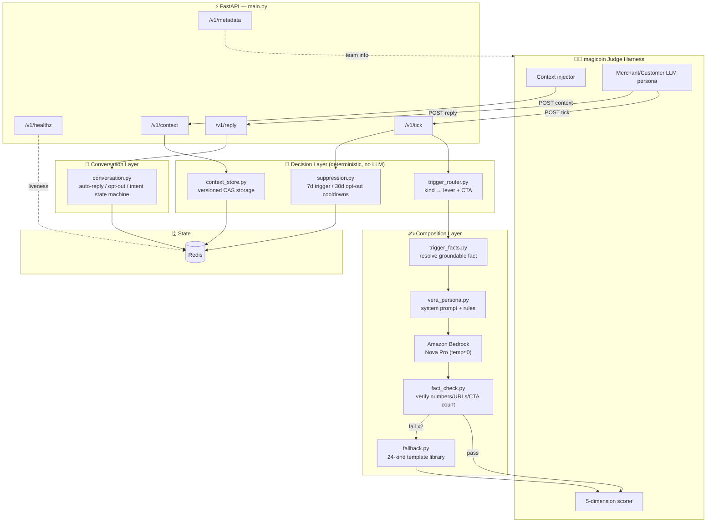
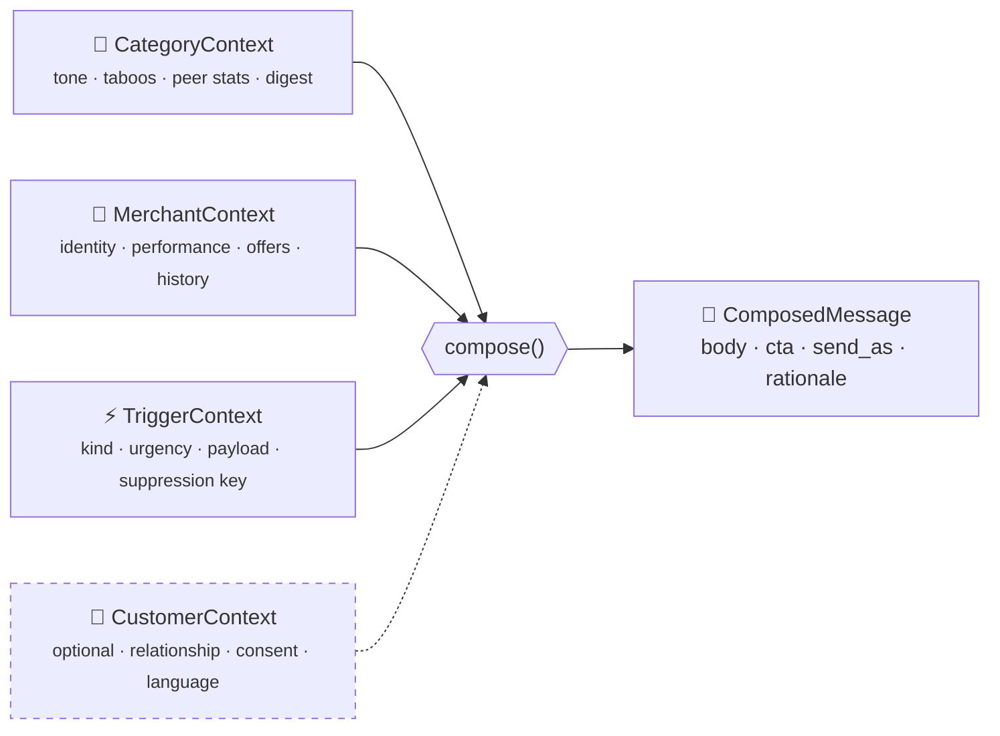
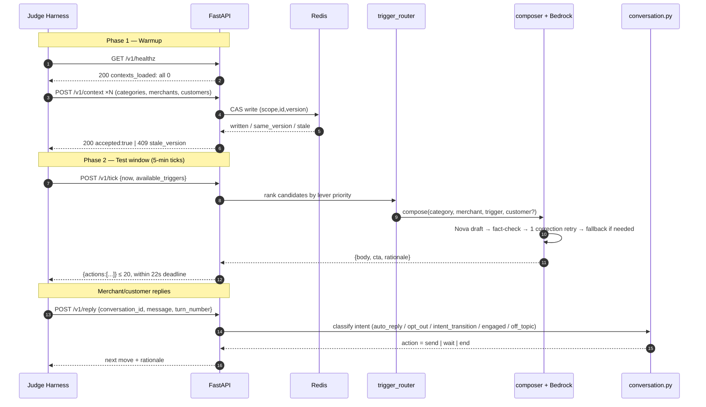
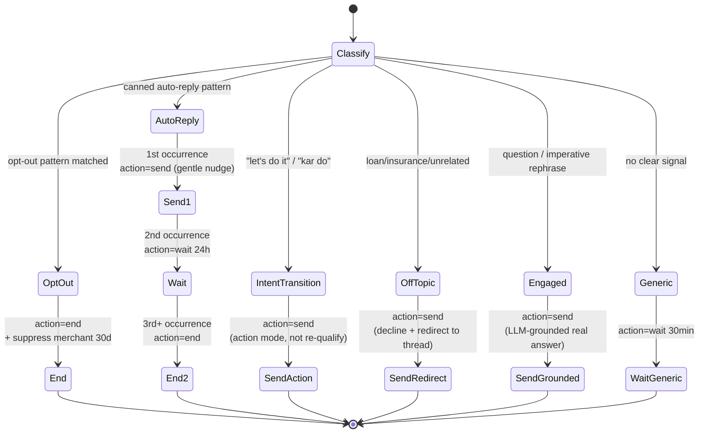
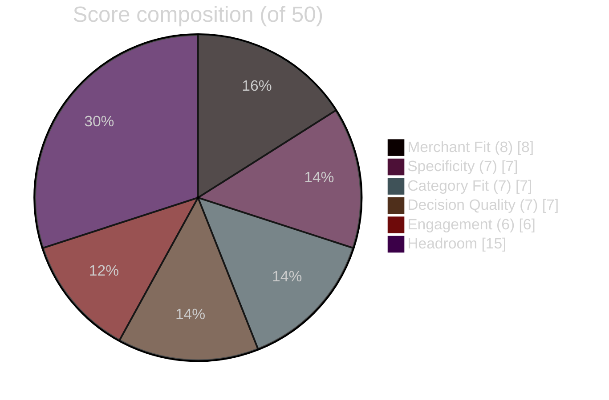
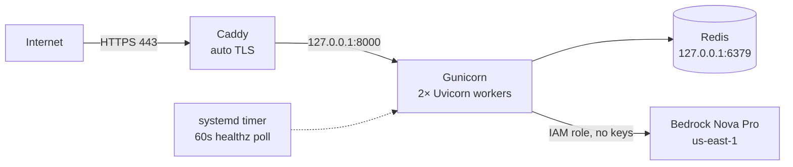

<div align="center">

# 🤖 Vera Bot

### An AI Growth Assistant Engine for the magicpin Vera AI Challenge

*A stateful, deterministic, fact-grounded composition engine that writes WhatsApp-style merchant & customer messages — built to survive unseen scenarios, not just pattern-match a sample set.*

[](https://www.python.org/)
[](https://fastapi.tiangolo.com/)
[](https://aws.amazon.com/bedrock/)
[](https://redis.io/)
[](#-testing)
[](#-score-breakdown)
[](#)

</div>

---

## 📖 Table of Contents

- [What is this?](#-what-is-this)
- [The Problem, In One Picture](#-the-problem-in-one-picture)
- [Architecture](#-architecture)
- [Module Map](#-module-map)
- [The 4-Context Composition Model](#-the-4-context-composition-model)
- [Request Lifecycle](#-request-lifecycle)
- [The Composer Pipeline](#-the-composer-pipeline)
- [Trigger → Strategy Routing Table](#-trigger--strategy-routing-table)
- [Conversation State Machine](#-conversation-state-machine)
- [Scoring Rubric & Math](#-scoring-rubric--math)
- [Score Breakdown](#-score-breakdown)
- [Bugs Found & Fixed](#-bugs-found--fixed)
- [Testing](#-testing)
- [Deployment](#-deployment)
- [Running Locally](#-running-locally)
- [Tradeoffs & Roadmap](#-tradeoffs--roadmap)

---

## 🎯 What is this?

**Vera** is magicpin's production AI assistant that messages ~7,000–10,000 merchants a day on WhatsApp — nudging them about performance, offers, research, and customer relationships. This repo is a from-scratch rebuild of Vera's *message composition engine*, submitted for the magicpin AI Challenge.

The core function being implemented, conceptually:

```
compose(category, merchant, trigger, customer?) → {
    body:            str,      # the WhatsApp message
    cta:             enum,     # binary_yes_no | open_ended | multi_choice
    send_as:         enum,     # "vera" | "merchant_on_behalf"
    suppression_key: str,      # dedup key
    rationale:       str       # why this message, for judge auditing
}
```

It's exposed behind **5 HTTP endpoints** that an AI judge harness calls automatically, pushes live context into, and scores against **5 quality dimensions** — before and after injecting scenarios the bot has never seen.

> [!IMPORTANT]
> The single biggest failure mode this project is engineered against: **overfitting to the 30 sample test pairs.** The real judge injects fresh digest items, performance shifts, and surprise customer contexts mid-test. A bot that memorizes sample phrasing fails; a bot that reasons from whatever context it's actually given survives.

---

## 🧩 The Problem, In One Picture

| | ❌ Generic (rejected) | ✅ High-compulsion (the bar) |
|---|---|---|
| **Message** | *"Hi Doctor, want to run a discount campaign today to increase sales?"* | *"190 people in your area searched for 'Dental Check Up' this week. Should I send them your ₹299 check-up offer?"* |
| **Trigger** | none cited | research digest, named |
| **Merchant fact** | none | real search count |
| **Offer** | none | real catalog price, verbatim |
| **CTA** | vague | single, binary, low-friction |

---

## 🏗️ Architecture



---

## 📂 Module Map

| Module | Responsibility | Lines* |
|---|---|---|
| `main.py` | Route wiring, validation, async parallel tick composition, customer fan-out | ~680 |
| `context_store.py` | Versioned, idempotent `(scope, context_id, version)` storage with CAS writes | ~200 |
| `trigger_router.py` | **24** trigger-kind → persuasion-lever + CTA lookup table, candidate ranking | ~90 |
| `trigger_facts.py` | Resolves a concrete, groundable fact string from real kind-specific trigger payloads | ~330 |
| `composer.py` | LLM prompt construction, Bedrock invocation, quality-gate evaluation, correction retry | ~640 |
| `vera_persona.py` | The full system prompt: persona, 4-context rules, zero-hallucination law, self-check | ~330 |
| `fact_check.py` | Numeric-claim extraction & verification, URL fabrication detection, CTA counting | ~90 |
| `offers.py` | Parses real `"<Service> @ ₹<price>"` offer titles, detects category↔merchant offer leakage | ~230 |
| `category_styles.py` | Per-category tone + banned-phrase configuration | ~55 |
| `fallback.py` | Deterministic template library — 24 trigger kinds × merchant/customer variants | ~900+ |
| `conversation.py` | `/v1/reply` state machine: auto-reply, opt-out, intent-transition, anti-repetition | ~230 |
| `suppression.py` | Per-trigger (7d) / per-merchant (30d) cooldowns, open-conversation dedup | ~135 |
| `state_backend.py` | Shared Redis-or-in-memory KV backend | ~120 |
| `validators.py` | Payload size/shape checks → clean 4xx, never a 500 | ~80 |

<sub>*Approximate, current codebase.</sub>

**Design principle:** *the LLM does style, an explicit rule layer does decisions.* Trigger selection, lever assignment, CTA type, offer citation, and suppression are all deterministic Python — never left for the model to "figure out" per-call. Nova's only job is turning an already-decided strategy into natural, grounded prose.

---

## 🧬 The 4-Context Composition Model

Every message is assembled from up to four independent context layers, fused at generation time:



| Layer | Refresh cadence | Drives |
|---|---|---|
| **Category** | Weekly (digest) / monthly (voice) | Tone, banned phrases, peer benchmarks, source-cited research |
| **Merchant** | Daily (perf) / real-time (conversation) | Specificity, offer citation, greeting name, language |
| **Trigger** | Per-event | *Why now* — the single signal the message is built around |
| **Customer** *(optional)* | Per-visit | Switches `send_as → merchant_on_behalf`, relationship framing, slot offers |

---

## 🔄 Request Lifecycle



---

## ⚙️ The Composer Pipeline

Every single outbound message runs through this exact gate sequence before it's allowed to leave the building:

```mermaid
flowchart TD
    Start(["compose() called"]) --> Cache{"Cached identical<br/>input already?"}
    Cache -->|yes| Return1["Return cached result<br/>(guarantees determinism)"]
    Cache -->|no| Draft1["Nova draft #1<br/>temp=0.00001, topK=1"]
    Draft1 --> Gate["Quality Gates"]

    Gate --> G1["✅ Every number verbatim<br/>in source context?"]
    Gate --> G2["✅ Zero banned phrases?"]
    Gate --> G3["✅ Zero fabricated URLs?"]
    Gate --> G4["✅ Offer cited if one<br/>exists & is relevant?"]
    Gate --> G5["✅ No category-catalog<br/>offer leakage?"]
    Gate --> G6["✅ Exactly one CTA,<br/>correct type?"]

    G1 & G2 & G3 & G4 & G5 & G6 --> Pass{"All gates pass?"}
    Pass -->|yes| Accept["Accept + cache"]
    Pass -->|no, attempt 1| Correct["Nova correction retry<br/>(named problems injected)"]
    Correct --> Gate2["Re-run all gates"]
    Gate2 -->|pass| Accept
    Gate2 -->|fail| Fallback["Deterministic fallback.py<br/>template (24 kinds covered)"]
    Fallback --> Accept

    style G1 fill:#1a3a1a
    style G2 fill:#1a3a1a
    style G3 fill:#1a3a1a
    style G4 fill:#1a3a1a
    style G5 fill:#1a3a1a
    style G6 fill:#1a3a1a
```



**Why this matters mathematically:** the challenge spec requires *"same input → same output."* Bedrock's Nova Invoke API has no seed parameter and rejects `temperature = 0` exactly (valid range `(0.00001, 1]`). So:

$$P(\text{Nova}(x) = \text{Nova}(x)) < 1 \quad \text{across two live calls}$$

The fix is a **memoization layer** keyed on a SHA-256 hash of the full input tuple:

$$\text{key} = \text{SHA256}\big(\text{category} \,\|\, \text{merchant} \,\|\, \text{trigger} \,\|\, \text{customer} \,\|\, \text{category\_ctx}\big)$$

$$\text{compose}(x) = \begin{cases} \text{cache}[\text{key}(x)] & \text{if } \text{key}(x) \in \text{cache} \\ \text{Nova}(x) \to \text{cache}[\text{key}(x)] & \text{otherwise} \end{cases}$$

This guarantees $\text{compose}(x) = \text{compose}(x)$ for all repeated calls — true determinism at the application layer, independent of the model's own sampling behavior.

---

## 🗺️ Trigger → Strategy Routing Table

All **24** trigger kinds from the real dataset are mapped to an explicit lever and CTA — never left for the LLM to improvise per call.

| Trigger kind | Lever | CTA | Priority |
|---|---|---|---|
| `active_planning_intent` | Effort externalization | `binary_yes_no` | 90 |
| `supply_alert` | Urgency + specificity | `open_ended` | 85 |
| `regulation_change` | Urgency + authority | `binary_yes_no` | 80 |
| `regulation_change_deadline` | Urgency + authority | `binary_yes_no` | 80 |
| `competitor_opened` | Loss aversion + action | `binary_yes_no` | 75 |
| `perf_dip` | Loss aversion | `binary_yes_no` | 70 |
| `renewal_due` | Loss aversion + urgency | `binary_yes_no` | 72 |
| `chronic_refill_due` | Specificity + trust | `binary_yes_no` | 68 |
| `recall_due` | Specificity + relationship | `multi_choice` | 65 |
| `customer_lapsed_hard` | No-shame winback | `binary_yes_no` | 63 |
| `wedding_package_followup` | Relationship continuity + urgency window | `binary_yes_no` | 61 |
| `winback_eligible` | Loss aversion + reciprocity | `binary_yes_no` | 62 |
| `festival_upcoming` | Urgency + local relevance | `binary_yes_no` | 60 |
| `review_theme_emerged` | Social proof + specificity | `open_ended` | 58 |
| `ipl_match_today` | Specificity + contrarian judgment | `open_ended` | 56 |
| `perf_spike` | Curiosity + opportunity | `open_ended` | 55 |
| `research_digest` | Curiosity + reciprocity | `open_ended` | 50 |
| `trial_followup` | Relationship continuity + low-friction booking | `binary_yes_no` | 47 |
| `gbp_unverified` | Loss aversion (missed visibility) | `binary_yes_no` | 48 |
| `category_seasonal` | Trend awareness + opportunity | `open_ended` | 44 |
| `milestone_reached` | Reciprocity + momentum | `open_ended` | 45 |
| `seasonal_perf_dip` | Anxiety pre-emption + reframe | `open_ended` | 42 |
| `curious_ask_due` | Direct question to merchant | `open_ended` | 40 |
| `cde_opportunity` | Reciprocity + low-effort value-add | `open_ended` | 35 |
| `dormant_with_vera` | Light curiosity, low pressure | `open_ended` | 30 |
| *(any unrecognized kind)* | Light curiosity, low pressure (safe default) | `open_ended` | 10 |

**Ranking function** when multiple triggers are eligible for the same merchant in the same tick:

$$\text{rank}(c) = -\big(\text{base\_priority}(c.\text{kind}) + \text{value\_score}(c)\big)$$

sorted ascending — highest combined priority wins, ties broken by stable input order for reproducibility.

---

## 💬 Conversation State Machine

`/v1/reply` never improvises turn-by-turn — it's a deterministic classifier feeding into 3 possible actions:



| Guard | Rule |
|---|---|
| **Turn-depth cap** | Conversations force-close after **6** turns regardless of content |
| **Anti-repetition** | SHA-256 fingerprint of every sent body; identical/near-duplicate body → converted to `wait` |
| **Suppression: trigger** | 7-day cooldown per `(merchant_id, suppression_key)` |
| **Suppression: merchant** | 30-day full block after a hard opt-out |
| **Conversation dedup** | At most 1 open conversation per `(merchant_id, trigger_id)` at a time |

---

## 📊 Scoring Rubric & Math

The official judge scores every composed message across **5 dimensions**, 0–10 each:

$$\text{Total} = \text{Specificity} + \text{CategoryFit} + \text{MerchantFit} + \text{DecisionQuality} + \text{Engagement} \quad \big/ 50$$

$$\text{Score \%} = \frac{\text{Total}}{50} \times 100$$

| Score % | Verdict |
|---:|---|
| ≥ 80% | 🟢 EXCELLENT |
| ≥ 60% | 🟡 GOOD |
| ≥ 40% | 🟠 NEEDS IMPROVEMENT |
| < 40% | 🔴 BELOW EXPECTATIONS |

Post-submission, the real judge additionally applies:

$$\text{FinalScore} = \text{Phase2Score} + \text{AdaptationBonus}_{\le 5/\text{dim}} + \text{ReplayScore}_{\le 30,\ \text{top-10 only}} - \text{Penalties}_{\le 20}$$

---

## 🏆 Score Breakdown

Self-tested locally against the real seed dataset (5 categories, 10 merchants, 25 triggers), scored by an independent judge pass over **25 composed messages**.

<table>
<tr><td>

| Dimension | Avg Score | Bar |
|---|---:|---|
| Merchant Fit | **8.0** / 10 | ████████░░ |
| Specificity | **7.0** / 10 | ███████░░░ |
| Category Fit | **7.0** / 10 | ███████░░░ |
| Decision Quality | **7.0** / 10 | ███████░░░ |
| Engagement Compulsion | **6.0** / 10 | ██████░░░░ |
| **Total** | **35 / 50** | **70% — GOOD** |

</td><td>



</td></tr>
</table>

**Distribution across all 25 scored messages:**

| Metric | Value |
|---|---|
| Minimum | 33 / 50 |
| Maximum | 41 / 50 |
| Median | 37 / 50 |
| Mean | 37.04 / 50 |
| Messages below 30 | 0 |
| Messages ≥ 40 (near-excellent) | 2 |

```
Score histogram (25 messages)
33 ████████ (4)
34 ██ (1)
36 ██ (1)
37 ████████████████████ (10)
38 ██ (1)
39 ████████ (4)
41 ████ (2)
```

> [!NOTE]
> This score was produced by the same model family (Bedrock Nova) both **composing** and **judging** the messages, via a local fork of the official `judge_simulator.py`. That's a directional sanity check, not a substitute for the real, independent magicpin judge — treat 70% as *"the plumbing is solid and quality is in the right neighborhood,"* not as a guaranteed submission score.

### Behavioral scenario results (all passing)

| Scenario | Expected | Result |
|---|---|---|
| Auto-reply escalation | send → wait(24h) → end | ✅ send → wait 86400s → end |
| Intent transition | switch to action mode, no re-qualifying | ✅ drafted concrete next step |
| Hostile message | graceful end | ✅ ended cleanly |
| Hard opt-out | end + 30d suppression | ✅ verified via follow-up tick returning `[]` |
| Off-topic curveball | decline + redirect | ✅ grounded, on-topic redirect |

---

## 🐛 Bugs Found & Fixed

A rigorous test pass against the **real** official dataset (not hand-written fixtures) surfaced concrete gaps versus the paraphrased spec the bot was originally built against. All of the following are fixed and covered by regression tests:

| # | Severity | Bug | Fix |
|---|:---:|---|---|
| 1 | 🔴 High | Customer-facing composition didn't exist — `/v1/tick` never read `trigger.customer_id`/`scope` | Added `CustomerContext` loading + dedicated `merchant_on_behalf` composition path |
| 2 | 🔴 High | Tick response missing 5/11 official fields (`conversation_id`, `customer_id`, `send_as`, `template_name`, `template_params`) | All 11 fields now present on every action |
| 3 | 🔴 High | Large tick batches (20+ triggers) blew the 30s SLA → 502, and suppression writes committed *before* the response was ever assembled → silent message loss | Bounded-concurrency `asyncio.gather` + 22s internal deadline; suppression deferred until full response built |
| 4 | 🟠 Medium | Context version conflicts always returned `200 accepted:true` even when silently rejected | Correct `409 {accepted:false, reason:stale_version, current_version:N}` |
| 5 | 🔴 High | Auto-reply detector missed the exact official test phrase (*"Thank you for contacting… will respond shortly"*) | Pattern list expanded to match the brief's own worked example |
| 6 | 🟠 Medium | Off-topic/engaged classifier had a high false-positive rate on imperative rephrasings ("tell me again" vs "what's…?") | Replaced allowlist with denylist + new `engaged` intent bucket |
| 7 | 🟠 Medium | `category_slug` vs `identity.category` / bare-slug vs `cat_`-prefixed lookup mismatch | Helper checks both real-dataset shapes |
| 8 | 🔴 High | Offer parsing assumed flat `{name, price}`; real data is `"Dental Cleaning @ ₹299"` strings — the mandatory offer-citation rule silently never fired | New `offers.py` regex-parses the real `"<name> @ ₹<price>"` pattern |
| 9 | 🟠 Medium | Category-catalog template offers cited as if they were a specific merchant's own live offer | `find_category_offer_leakage()` post-generation check |
| 10 | 🟠 Medium | 14 of 24 real trigger kinds had no strategy/fallback, silently defaulting to the weakest lever | All 24 kinds now have dedicated strategy + fallback template |
| 11 | 🟡 Low | Merchant greeted by full business name instead of owner's first name | Prefers `identity.owner_first_name` |
| 12 | 🟠 Medium | No mechanical check against fabricated URLs | `fact_check.find_urls()` gate added |
| 13 | 🟡 Low | `/v1/reply`'s `wait` action never carried `wait_seconds` | Added per official examples |

---

## ✅ Testing

```
$ pytest tests/ -v
================= 69 passed, 144 warnings in 93.61s (0:01:33) =================
```

| Test file | Focus |
|---|---|
| `test_composer.py` | Fact-verification, no-hallucination, offer citation, unknown-kind safety |
| `test_conversation.py` | Auto-reply escalation, opt-out, intent-transition, anti-repetition, turn cap |
| `test_endpoints.py` | Contract tests for all 5 endpoints, idempotency, 4xx/413 handling |
| `test_live_bedrock.py` | Live Nova Pro calls against the challenge brief's own worked example |
| `test_load.py` | 10 req/sec concurrency, sub-30s latency, determinism |
| `test_real_dataset.py` | End-to-end against **real** `magicpin-ai-challenge/dataset/*.json` shapes |
| `test_reply_grounding.py` | LLM-grounded replies, open-conversation dedup, production Redis guard |
| `test_unseen_scenarios.py` | Hand-written combos absent from any sample data — the anti-overfitting check |

**Live harness runs** (`test_harness.py`, 90 requests) against the deployed public URL confirmed:
- All 25 seed triggers in a single tick → correctly capped at 20 actions, zero data loss
- Customer-scoped `recall_due` → `send_as: merchant_on_behalf`, correct offer + slot citation
- Full reply scenario suite (engaged, auto-reply ×4, opt-out, intent transition, curveball, hostile, Hinglish, anti-repetition) — all passing

---

## 🚀 Deployment

| Component | Choice |
|---|---|
| Compute | AWS EC2 `t3.medium` (2 vCPU / 4GB) — I/O-bound on Bedrock, not CPU-bound |
| App server | Gunicorn + 2 Uvicorn workers, `--timeout 30` |
| State | Redis, `appendonly yes`, bound to `127.0.0.1` only |
| TLS | Caddy reverse proxy, auto Let's Encrypt via `sslip.io` |
| Process supervision | `systemd` unit, `Restart=always` |
| Health watchdog | `systemd` timer, curls `/v1/healthz` every 60s |
| LLM auth | EC2 IAM role in prod (zero long-lived credentials); bearer-token via `.env` for local dev |



---

## 🖥️ Running Locally

```bash
pip install -r requirements.txt
uvicorn main:app --host 127.0.0.1 --port 8000
```

Optional `.env` (see `.env.example`) for Bedrock credentials and `REDIS_URL`. Without either, the service runs correctly on the deterministic fallback composer and in-memory state (single process only).

```bash
pytest tests/ -v
```

---

## 🔭 Tradeoffs & Roadmap

| Area | Current state | Next step |
|---|---|---|
| Engagement compulsion (weakest scoring dimension, 6/10 avg) | Curiosity + specificity dominate | Add explicit lever-usage gate for loss-aversion/social-proof triggers |
| Fallback visibility | No metric on Nova-vs-fallback ratio in production | Instrument and log the split |
| Dataset coverage | Tested against 10/25 seed set | Run against the full expanded 50-merchant/100-trigger/30-canonical-pair dataset |
| Judge independence | Self-scored by same model family (Nova judging Nova) | Run at least one pass with an independent judge model |
| Trigger ranking | Static `base_priority` table only | Blend in the trigger's live `urgency` field as a tie-breaker |

---

<div align="center">

**Built for the magicpin Vera AI Challenge** · Team *Airo*

</div>
