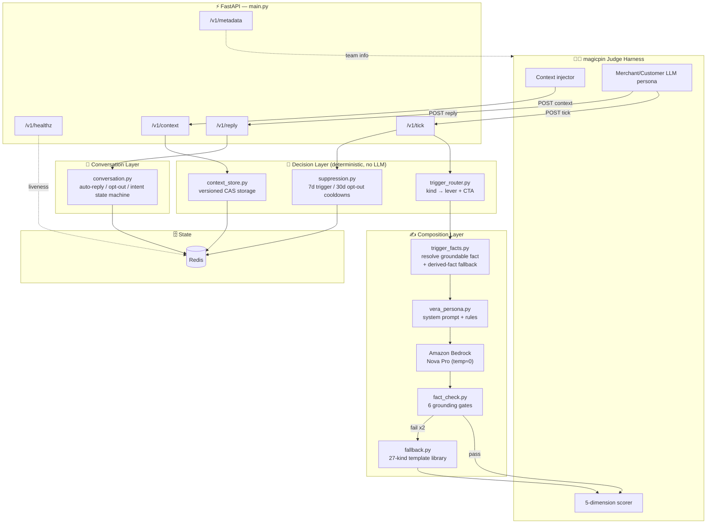
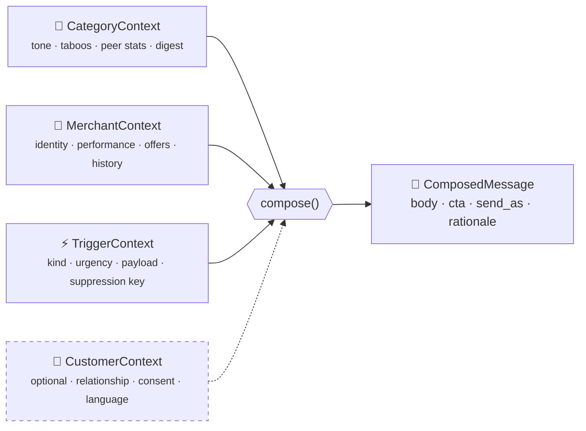
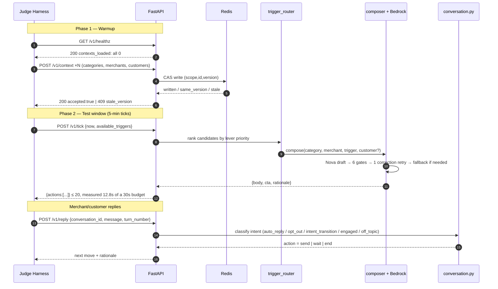
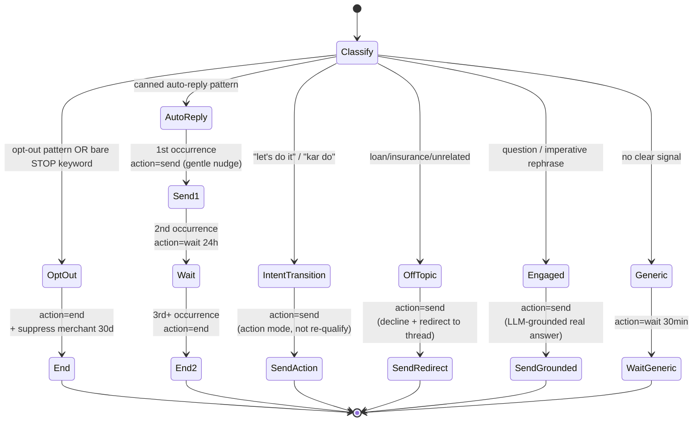
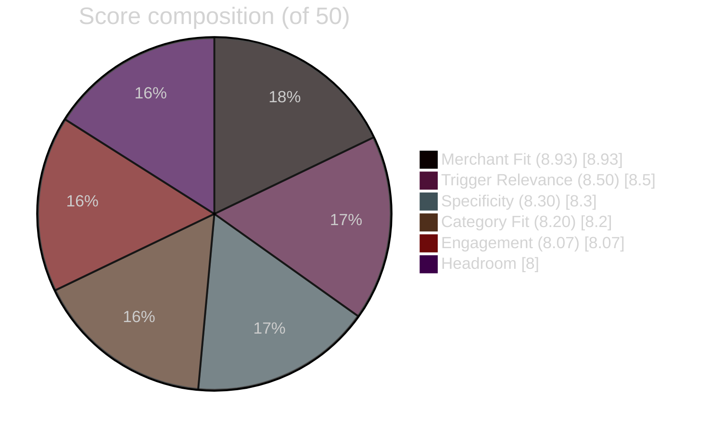
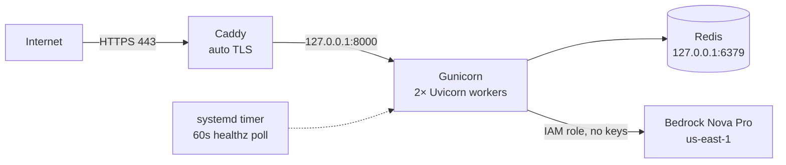

<div align="center">

# 🤖 Vera Bot

### An AI Growth Assistant Engine for the magicpin Vera AI Challenge

*A stateful, deterministic, fact-grounded composition engine that writes WhatsApp-style merchant & customer messages — built to survive unseen scenarios, not just pattern-match a sample set.*

[](https://www.python.org/)
[](https://fastapi.tiangolo.com/)
[](https://aws.amazon.com/bedrock/)
[](https://redis.io/)
[](#-testing)
[](#-score-breakdown)
[](#-score-breakdown)
[](#)
[](#)

</div>

---

## 📖 Table of Contents

- [What is this?](#-what-is-this)
- [The Problem, In One Picture](#-the-problem-in-one-picture)
- [Architecture](#-architecture)
- [Module Map](#-module-map)
- [The 4-Context Composition Model](#-the-4-context-composition-model)
- [Request Lifecycle](#-request-lifecycle)
- [The Composer Pipeline](#-the-composer-pipeline)
- [Trigger → Strategy Routing Table](#-trigger--strategy-routing-table)
- [Conversation State Machine](#-conversation-state-machine)
- [Scoring Rubric & Math](#-scoring-rubric--math)
- [Score Breakdown](#-score-breakdown)
- [The Placeholder-Payload Problem](#-the-placeholder-payload-problem)
- [Bugs Found & Fixed](#-bugs-found--fixed)
- [Testing](#-testing)
- [Deployment](#-deployment)
- [Running Locally](#-running-locally)
- [Tradeoffs & Roadmap](#-tradeoffs--roadmap)

---

## 🎯 What is this?

**Vera** is magicpin's production AI assistant that messages ~7,000–10,000 merchants a day on WhatsApp — nudging them about performance, offers, research, and customer relationships. This repo is a from-scratch rebuild of Vera's *message composition engine*, submitted for the magicpin AI Challenge.

The core function being implemented, conceptually:

```
compose(category, merchant, trigger, customer?) → {
    body:            str,      # the WhatsApp message
    cta:             enum,     # binary_yes_no | open_ended | multi_choice
    send_as:         enum,     # "vera" | "merchant_on_behalf"
    suppression_key: str,      # dedup key
    rationale:       str       # why this message, for judge auditing
}
```

It's exposed behind **5 HTTP endpoints** that an AI judge harness calls automatically, pushes live context into, and scores against **5 quality dimensions** — before and after injecting scenarios the bot has never seen.

> [!IMPORTANT]
> The single biggest failure mode this project is engineered against: **overfitting to the 30 sample test pairs.** The real judge injects fresh digest items, performance shifts, and surprise customer contexts mid-test. A bot that memorizes sample phrasing fails; a bot that reasons from whatever context it's actually given survives.

---

## 🧩 The Problem, In One Picture

| | ❌ Generic (rejected) | ✅ High-compulsion (the bar) |
|---|---|---|
| **Message** | *"Hi Doctor, want to run a discount campaign today to increase sales?"* | *"190 people in your area searched for 'Dental Check Up' this week. Should I send them your ₹299 check-up offer?"* |
| **Trigger** | none cited | research digest, named |
| **Merchant fact** | none | real search count |
| **Offer** | none | real catalog price, verbatim |
| **CTA** | vague | single, binary, low-friction |

---

## 🏗️ Architecture



---

## 📂 Module Map

| Module | Responsibility | Lines* |
|---|---|---|
| `main.py` | Route wiring, validation, async parallel tick composition, customer fan-out | ~677 |
| `bot.py` | §7.1 deliverable — `compose()` adapter over the same pipeline; regenerates `submission.jsonl` | ~205 |
| `context_store.py` | Versioned, idempotent `(scope, context_id, version)` storage with CAS writes | ~197 |
| `trigger_router.py` | **27** trigger-kind → persuasion-lever + CTA lookup table, candidate ranking | ~103 |
| `trigger_facts.py` | Resolves a groundable fact from real trigger payloads; **derives one from adjacent context when the payload is a placeholder** | ~830 |
| `composer.py` | LLM prompt construction, Bedrock invocation, quality-gate evaluation, correction retry | ~788 |
| `vera_persona.py` | The full system prompt: persona, 4-context rules, zero-hallucination law, self-check | ~492 |
| `fact_check.py` | Numeric verification, fabricated clock times, URL detection, offer eligibility, appointment assertions, CTA counting | ~279 |
| `offers.py` | Parses real `"<Service> @ ₹<price>"` offer titles, detects category↔merchant offer leakage | ~232 |
| `category_styles.py` | Per-category tone + banned-phrase configuration, read from the real nested `voice` shape | ~115 |
| `fallback.py` | Deterministic template library — 27 trigger kinds × merchant/customer variants | ~1065 |
| `conversation.py` | `/v1/reply` state machine: auto-reply, opt-out, intent-transition, anti-repetition | ~252 |
| `suppression.py` | Per-trigger (7d) / per-merchant (30d) cooldowns, open-conversation dedup | ~123 |
| `state_backend.py` | Shared Redis-or-in-memory KV backend | ~117 |
| `validators.py` | Payload size/shape checks → clean 4xx, never a 500 | ~115 |
| `gemini_judge.py` | Independent-judge harness (Gemini, *not* Nova) behind every score below | ~358 |

<sub>*Approximate, current codebase.</sub>

**Design principle:** *the LLM does style, an explicit rule layer does decisions.* Trigger selection, lever assignment, CTA type, offer citation, and suppression are all deterministic Python — never left for the model to "figure out" per-call. Nova's only job is turning an already-decided strategy into natural, grounded prose.

---

## 🧬 The 4-Context Composition Model

Every message is assembled from up to four independent context layers, fused at generation time:



| Layer | Refresh cadence | Drives |
|---|---|---|
| **Category** | Weekly (digest) / monthly (voice) | Tone, banned phrases, peer benchmarks, source-cited research |
| **Merchant** | Daily (perf) / real-time (conversation) | Specificity, offer citation, greeting name, language |
| **Trigger** | Per-event | *Why now* — the single signal the message is built around |
| **Customer** *(optional)* | Per-visit | Switches `send_as → merchant_on_behalf`, relationship framing, slot offers |

> [!NOTE]
> When a trigger payload carries no event data, the other three layers still do. The **derived-fact layer** (`trigger_facts.py`) grounds the message in real 7-day performance deltas, category peer benchmarks, cumulative customer counts, subscription state, or visit history — rather than degrading to generic copy. Every value is read verbatim from a pushed payload; when nothing exists anywhere it returns nothing, so templates degrade honestly instead of inventing specificity.

---

## 🔄 Request Lifecycle



---

## ⚙️ The Composer Pipeline

Every single outbound message runs through this exact gate sequence before it's allowed to leave the building:

```mermaid
flowchart TD
    Start(["compose() called"]) --> Cache{"Cached identical<br/>input already?"}
    Cache -->|yes| Return1["Return cached result<br/>(guarantees determinism)"]
    Cache -->|no| Fact["Resolve fact<br/>(payload, else derived<br/>from adjacent context)"]
    Fact --> Draft1["Nova draft #1<br/>temp=0.00001, topK=1"]
    Draft1 --> Gate["Quality Gates"]

    Gate --> G1["✅ Every number verbatim<br/>in source context?"]
    Gate --> G2["✅ No invented clock time<br/>for this recipient?"]
    Gate --> G3["✅ Zero fabricated URLs?"]
    Gate --> G4["✅ No category-catalog<br/>offer leakage?"]
    Gate --> G5["✅ Offer eligibility valid<br/>for this customer?"]
    Gate --> G6["✅ No unsupported<br/>appointment assertion?"]
    Gate --> G7["✅ Zero banned phrases?"]
    Gate --> G8["✅ Exactly one CTA,<br/>correct type?"]

    G1 & G2 & G3 & G4 & G5 & G6 & G7 & G8 --> Pass{"All gates pass?"}
    Pass -->|yes| Accept["Accept + cache"]
    Pass -->|no, attempt 1| Correct["Nova correction retry<br/>(named problems injected)"]
    Correct --> Gate2["Re-run all gates"]
    Gate2 -->|pass| Accept
    Gate2 -->|fail| Fallback["Deterministic fallback.py<br/>template (27 kinds covered)"]
    Fallback --> Accept

    style G1 fill:#1a3a1a
    style G2 fill:#1a3a1a
    style G3 fill:#1a3a1a
    style G4 fill:#1a3a1a
    style G5 fill:#1a3a1a
    style G6 fill:#1a3a1a
    style G7 fill:#1a3a1a
    style G8 fill:#1a3a1a
```



**Why this matters mathematically:** the challenge spec requires *"same input → same output."* Bedrock's Nova Invoke API has no seed parameter and rejects `temperature = 0` exactly (valid range `(0.00001, 1]`). So:

$$P(\text{Nova}(x) = \text{Nova}(x)) < 1 \quad \text{across two live calls}$$

The fix is a **memoization layer** keyed on a SHA-256 hash of the full input tuple:

$$\text{key} = \text{SHA256}\big(\text{category} \,\|\, \text{merchant} \,\|\, \text{trigger} \,\|\, \text{customer} \,\|\, \text{category\_ctx}\big)$$

$$\text{compose}(x) = \begin{cases} \text{cache}[\text{key}(x)] & \text{if } \text{key}(x) \in \text{cache} \\ \text{Nova}(x) \to \text{cache}[\text{key}(x)] & \text{otherwise} \end{cases}$$

This guarantees $\text{compose}(x) = \text{compose}(x)$ for all repeated calls — true determinism at the application layer, independent of the model's own sampling behavior.

---

## 🗺️ Trigger → Strategy Routing Table

All **27** trigger kinds from the real dataset are mapped to an explicit lever and CTA — never left for the LLM to improvise per call.

| Trigger kind | Lever | CTA | Priority |
|---|---|---|---|
| `active_planning_intent` | Effort externalization | `binary_yes_no` | 90 |
| `supply_alert` | Urgency + specificity | `open_ended` | 85 |
| `regulation_change` | Urgency + authority | `binary_yes_no` | 80 |
| `regulation_change_deadline` | Urgency + authority | `binary_yes_no` | 80 |
| `appointment_tomorrow` | Utility reminder + low-friction confirm | `binary_yes_no` | 78 |
| `competitor_opened` | Loss aversion + action | `binary_yes_no` | 75 |
| `renewal_due` | Loss aversion + urgency | `binary_yes_no` | 72 |
| `perf_dip` | Loss aversion | `binary_yes_no` | 70 |
| `chronic_refill_due` | Specificity + trust | `binary_yes_no` | 68 |
| `recall_due` | Specificity + relationship | `multi_choice` | 65 |
| `customer_lapsed_hard` | No-shame winback | `binary_yes_no` | 63 |
| `winback_eligible` | Loss aversion + reciprocity | `binary_yes_no` | 62 |
| `wedding_package_followup` | Relationship continuity + urgency window | `binary_yes_no` | 61 |
| `festival_upcoming` | Urgency + local relevance | `binary_yes_no` | 60 |
| `review_theme_emerged` | Social proof + specificity | `open_ended` | 58 |
| `ipl_match_today` | Specificity + contrarian judgment | `open_ended` | 56 |
| `perf_spike` | Curiosity + opportunity | `open_ended` | 55 |
| `customer_lapsed_soft` | Gentle loss aversion (early nudge, not winback) | `binary_yes_no` | 54 |
| `research_digest` | Curiosity + reciprocity | `open_ended` | 50 |
| `gbp_unverified` | Loss aversion (missed visibility) | `binary_yes_no` | 48 |
| `trial_followup` | Relationship continuity + low-friction booking | `binary_yes_no` | 47 |
| `milestone_reached` | Reciprocity + momentum | `open_ended` | 45 |
| `category_seasonal` | Trend awareness + opportunity | `open_ended` | 44 |
| `seasonal_perf_dip` | Anxiety pre-emption + reframe | `open_ended` | 42 |
| `curious_ask_due` | Direct question to merchant | `open_ended` | 40 |
| `cde_opportunity` | Reciprocity + low-effort value-add | `open_ended` | 35 |
| `dormant_with_vera` | Light curiosity, low pressure | `open_ended` | 30 |
| *(any unrecognized kind)* | Light curiosity, low pressure (safe default) | `open_ended` | 10 |

**Ranking function** when multiple triggers are eligible for the same merchant in the same tick:

$$\text{rank}(c) = -\big(\text{base\_priority}(c.\text{kind}) + \text{value\_score}(c)\big)$$

sorted ascending — highest combined priority wins, ties broken by stable input order for reproducibility.

---

## 💬 Conversation State Machine

`/v1/reply` never improvises turn-by-turn — it's a deterministic classifier feeding into 3 possible actions:



| Guard | Rule |
|---|---|
| **Turn-depth cap** | Conversations force-close after **6** turns regardless of content |
| **Anti-repetition** | SHA-256 fingerprint of every sent body; identical/near-duplicate body → converted to `wait` |
| **Suppression: trigger** | 7-day cooldown per `(merchant_id, suppression_key)` |
| **Suppression: merchant** | 30-day full block after a hard opt-out |
| **Conversation dedup** | At most 1 open conversation per `(merchant_id, trigger_id)` at a time |
| **Bare-keyword opt-out** | A message that *is* `STOP` / `UNSUBSCRIBE` / `OPT OUT` / `QUIT` ends + suppresses; ambiguous words (`no`, `cancel`) deliberately excluded |

---

## 📊 Scoring Rubric & Math

The official judge scores every composed message across **5 dimensions**, 0–10 each:

$$\text{Total} = \text{Specificity} + \text{CategoryFit} + \text{MerchantFit} + \text{TriggerRelevance} + \text{Engagement} \quad \big/ 50$$

$$\text{Score \%} = \frac{\text{Total}}{50} \times 100$$

| Score % | Verdict |
|---:|---|
| ≥ 80% | 🟢 EXCELLENT |
| ≥ 60% | 🟡 GOOD |
| ≥ 40% | 🟠 NEEDS IMPROVEMENT |
| < 40% | 🔴 BELOW EXPECTATIONS |

Post-submission, the real judge additionally applies:

$$\text{FinalScore} = \text{Phase2Score} + \text{AdaptationBonus}_{\le 5/\text{dim}} + \text{ReplayScore}_{\le 30,\ \text{top-10 only}} - \text{Penalties}_{\le 20}$$

---

## 🏆 Score Breakdown

Scored against the **full official canonical set — all 30 (merchant, trigger) pairs** — captured live from the deployed service and graded by an **independent judge model** (Google Gemini).

<table>
<tr><td>

| Dimension | Avg Score | Bar |
|---|---:|---|
| Merchant Fit | **8.93** / 10 | █████████░ |
| Trigger Relevance | **8.50** / 10 | ████████▌░ |
| Specificity | **8.30** / 10 | ████████░░ |
| Category Fit | **8.20** / 10 | ████████░░ |
| Engagement Compulsion | **8.07** / 10 | ████████░░ |
| **Total** | **42.00 / 50** | **84% — EXCELLENT** |

</td><td>



</td></tr>
</table>

**Distribution across all 30 scored messages:**

| Metric | Value |
|---|---|
| Minimum | 26 / 50 |
| Maximum | **50 / 50** (perfect) |
| Median | 44 / 50 |
| Mean | 42.00 / 50 |
| Messages below 30 | 3 |
| Messages ≥ 40 | 23 |
| Messages ≥ 45 (near-perfect) | 13 |
| **Fabrication / jargon penalties** | **0** |

```
Score histogram (30 messages)
26 █ (1)
27 █ (1)
28 █ (1)
33 █ (1)
34 █ (1)
37 █ (1)
38 █ (1)
40 █ (1)
41 ██ (2)
43 ███ (3)
44 ████ (4)
45 ███ (3)
46 ██ (2)
47 ███ (3)
48 ████ (4)
50 █ (1)
```

### Iteration history

Every row is a full 30-pair run against the live service, same judge, same rubric.

| Build | Score | Spec | Cat | Merch | Trig | Eng | Penalties |
|---|---|---|---|---|---|---|---|
| baseline | 32.97 / 65.9% | 5.90 | 6.83 | 6.60 | 7.20 | 6.53 | 3 |
| iteration 1 | 36.90 / 73.8% | 7.17 | 7.57 | 7.27 | 8.00 | 7.13 | 7 |
| iteration 2 | 39.53 / 79.1% | 7.63 | 7.83 | 8.43 | 8.27 | 7.57 | 6 |
| iteration 3 | 41.00 / 82.0% | 8.20 | 7.93 | 8.63 | 8.53 | 7.77 | 2 |
| **2.1.4** | **42.00 / 84.0%** | **8.30** | **8.20** | **8.93** | **8.50** | **8.07** | **0** |

Net **+9.03 points (+27% relative)**, every dimension improved, penalties driven from 3 to **0**.

> [!NOTE]
> The penalty column is the figure worth reading. It *rose* to 7 during iteration 1 — pushing for specificity increases fabrication risk — and only closed to 0 once the grounding gates caught up. Specificity and zero-fabrication are in direct tension on this dataset, and the current build sits where they balance.

> [!WARNING]
> **Honest caveats.** Nova is not perfectly deterministic on a cold cache, so individual pairs swung widely between runs (one moved 22 → 43 → 20 → 43). The aggregate trend across five runs is the trustworthy signal; a single pair's number is not — treat 42.00 as roughly **±1.5–2**. Only one judge model was used; the official judge is a different, unknown model. Earlier self-scoring in this repo used Nova to grade Nova's own output and was discarded as favourably biased.

### Operational verification

| Measurement | Result | Limit |
|---|---|---|
| `/v1/tick`, 20 actions, cold cache | **12.81s** / 12.41s | 30s |
| Per-action composition | 0.64s | — |
| `/v1/tick`, warm cache | 3.70s | 30s |
| `/v1/healthz` *during* a 12.41s tick | 7/7 × HTTP 200, max 1.87s | 3 consecutive failures = disqualification |
| 355 context pushes (reused connection) | 93s (263ms each) | 15-min warmup window |

Composition is concurrent, not sequential — the 0.64s-per-action figure confirms it. Worst case is bounded too: on a transient Bedrock failure the composer returns immediately rather than retrying, so a throttle burst cannot multiply into a timeout.

### Behavioral scenario results (all passing, verified live)

| Scenario | Expected | Result |
|---|---|---|
| Auto-reply escalation (same canned text ×4) | send → wait → end | ✅ send → wait → end → end |
| Intent transition (*"ok let's do it"*) | switch to action, no re-pitch | ✅ confirmed the specific agreed item |
| Hostile, then off-topic (GST question) | stay on-mission politely | ✅ declined the unrelated ask, redirected to the live topic |
| Hard opt-out (`STOP`) | end + 30d suppression | ✅ `end` + merchant suppressed |
| **Phase 3** — new digest item injected at v2 | adopt new fact, drop stale | ✅ cited the new 41% finding, zero stale leakage |
| **Phase 3** — performance snapshot updated | use fresh numbers | ✅ *"views are up 44% week-on-week (now 9999 over 30 days)"* |
| **Phase 3** — mid-test customer + `recall_due` | compose customer-directed | ✅ greeted by name, real due date, real slot, real offer |

---

## 🎯 The Placeholder-Payload Problem

The largest single scoring gap in this project, and the reason for the derived-fact layer.

magicpin's generator hand-authors **25** triggers with real event payloads and synthesises the remaining **75** with a bare payload:

```json
{ "placeholder": true, "metric_or_topic": "<kind>" }
```

**13 of the 30 graded pairs land on one of those.** Splitting the baseline run by payload type isolated it exactly:

| Pair group | n | Baseline average |
|---|---|---|
| Real hand-authored payload | 17 | **39.8 / 50** |
| Synthetic placeholder payload | 13 | **24.1 / 50** |

All five worst-scoring messages were placeholder pairs, with the judge repeatedly citing *"too generic"*, *"no concrete verifiable facts"*, *"could be copy-pasted to any merchant"*.

> [!IMPORTANT]
> **This was never a model-capability problem.** Nova scored 39–48/50 whenever it had real data. Every worst message came from a deterministic fallback template the model never got to improve on, because the trigger carried nothing to anchor to.

The fix is not to invent event data. It is to notice the merchant, customer and category contexts pushed *alongside* the trigger are still full of real, citable numbers:

```
placeholder trigger ──► 7-day performance deltas       (performance.delta_7d)
                    ──► category peer benchmarks       (peer_stats, incl. at-par)
                    ──► cumulative customer counts     (customer_aggregate)
                    ──► subscription state             (lapsed / renewing soon)
                    ──► customer visit history         (count, last-visit date)
                    ──► nothing exists → return None, degrade honestly
```

*Live effect:* `"Vikas, your numbers are trending up this week"` → `"Vikas, your calls are up 5% week-on-week (now 14 over 30 days)"`.

---

## 🐛 Bugs Found & Fixed

Two rigorous passes surfaced concrete gaps. Bugs 1–13 came from testing against the **real** official dataset rather than hand-written fixtures. Bugs 14–24 were surfaced only by **independent judging of all 30 canonical pairs** — every one passed the existing unit suite. All are fixed and covered by regression tests naming the pair they came from.

| # | Severity | Bug | Fix |
|---|:---:|---|---|
| 1 | 🔴 High | Customer-facing composition didn't exist — `/v1/tick` never read `trigger.customer_id`/`scope` | Added `CustomerContext` loading + dedicated `merchant_on_behalf` composition path |
| 2 | 🔴 High | Tick response missing 5/11 official fields (`conversation_id`, `customer_id`, `send_as`, `template_name`, `template_params`) | All 11 fields now present on every action |
| 3 | 🔴 High | Large tick batches (20+ triggers) blew the 30s SLA → 502, and suppression writes committed *before* the response was assembled → silent message loss | Bounded-concurrency `asyncio.gather` + 22s internal deadline; suppression deferred until full response built |
| 4 | 🟠 Medium | Context version conflicts always returned `200 accepted:true` even when silently rejected | Correct `409 {accepted:false, reason:stale_version, current_version:N}` |
| 5 | 🔴 High | Auto-reply detector missed the exact official test phrase (*"Thank you for contacting… will respond shortly"*) | Pattern list expanded to match the brief's own worked example |
| 6 | 🟠 Medium | Off-topic/engaged classifier had a high false-positive rate on imperative rephrasings | Replaced allowlist with denylist + new `engaged` intent bucket |
| 7 | 🟠 Medium | `category_slug` vs `identity.category` / bare-slug vs `cat_`-prefixed lookup mismatch | Helper checks both real-dataset shapes |
| 8 | 🔴 High | Offer parsing assumed flat `{name, price}`; real data is `"Dental Cleaning @ ₹299"` strings — the mandatory offer-citation rule silently never fired | New `offers.py` regex-parses the real `"<name> @ ₹<price>"` pattern |
| 9 | 🟠 Medium | Category-catalog template offers cited as if they were a merchant's own live offer | `find_category_offer_leakage()` post-generation check |
| 10 | 🟠 Medium | 14 of 24 real trigger kinds had no strategy/fallback, silently defaulting to the weakest lever | All kinds now have dedicated strategy + fallback template |
| 11 | 🟡 Low | Merchant greeted by full business name instead of owner's first name | Prefers `identity.owner_first_name` |
| 12 | 🟠 Medium | No mechanical check against fabricated URLs | `fact_check.find_urls()` gate added |
| 13 | 🟡 Low | `/v1/reply`'s `wait` action never carried `wait_seconds` | Added per official examples |
| 14 | 🔴 High | `category_styles` read a flat `payload["tone"]`; real data nests it under `payload["voice"]` with `vocab_taboo`. Nothing raised — **every** real category push silently fell back to generic defaults, so per-category voice was never applied | Reads the nested shape first, keeps flat as fixture fallback, adds `vocab_allowed` + `tone_examples` to the prompt |
| 15 | 🔴 High | `appointment_tomorrow` and `customer_lapsed_soft` had no strategy mapping despite appearing in 4 canonical pairs (T03/T04, T14/T15) | Both mapped, with a gentler lever for soft-lapse than hard winback |
| 16 | 🔴 High | Nova fabricated *"at 7am"* for an appointment with no time data — `verify_numeric_claims` only checked bare-digit presence, matching an unrelated review count | `find_fabricated_clock_times()` scoped to merchant/trigger/customer, deliberately **excluding** the category digest (a gym's "7am class" would mask real fabrications) |
| 17 | 🔴 High | Broken surrogate escapes crashed Starlette's JSON renderer → **HTTP 500 for an entire tick batch** | Fixed literals, added a sanitiser and an HTTP-layer guard that drops only the offending action |
| 18 | 🔴 High | Placeholder-payload triggers produced generic copy — 13/30 graded pairs averaging 24.1/50 | **Derived-fact layer** (see [above](#-the-placeholder-payload-problem)) |
| 19 | 🔴 High | A **dentist** sent *"your regular medicines are running low"* — the generator attaches `chronic_refill_due` to non-pharmacies. Scored **5/50** with a fabrication penalty | Refill copy restricted to dispensing categories; others reframe as care-continuity |
| 20 | 🔴 High | Peer comparison returned nothing when a merchant sat **exactly** at the category average (sentinel `0.0` against a `>= 0` guard) → a fully generic 15/50 message | Sentinel corrected; ties read *"in line with the peer benchmark"* |
| 21 | 🟠 Medium | A **new-patients-only** offer promised to a patient with 5 prior visits — a false eligibility claim | `find_new_customer_offer_mismatch()` gate |
| 22 | 🟠 Medium | A confirmed appointment asserted to a **lapsed** customer with no booking data (−2 penalty, trigger relevance 2/10) | `find_unsupported_appointment_assertion()`; an enumeration-based first attempt was **evaded live**, so it now works by co-occurrence with slot-offer exemptions |
| 23 | 🟠 Medium | A **Tue–Thu-only** offer recommended for a **Saturday**; `vs_baseline` (a window total) labelled as a per-day rate; Diwali pitched with live urgency **188 days** out; trend tokens rendered unitless (`"+40"`); *"your CTR **are**"*; passive dormancy close scored 3/10 on engagement | Day-restriction check, correct baseline wording, planning-horizon reframe beyond ~8 weeks, `%` units, per-metric verb agreement, concrete offer-to-draft close |
| 24 | 🔴 High | **A bare `STOP` was not an opt-out.** Every pattern needed "stop" + a second word, so `"STOP"` fell through to *no-signal → wait*: conversation left open, merchant never suppressed. The brief specifies Vera's own CTAs as *"binary choice (YES/STOP)"* — the service told merchants to reply STOP, then ignored it | Standalone-keyword detection, matched only when the keyword is the entire message (`"don't stop sending these"` does not trip); ambiguous `no`/`cancel` deliberately excluded |

> [!NOTE]
> **One "bug" turned out to be in the measurement, not the product.** An early version of `gemini_judge.py` omitted `customer_aggregate` from the merchant context shown to the scorer and never stated who a message was addressed to — producing two false fabrication penalties. Passing the full payload and declaring the addressee moved those pairs **13 → 43** and **34 → 44** with zero code change. Recorded because it is a live risk: if the official judge shows its scorer less context than the bot received, correctly grounded citations can still read as fabricated.

---

## ✅ Testing

```
$ pytest tests/ -q
================= 124 passed, 150 warnings in 113.05s (0:01:53) =================
```

| Test file | Focus |
|---|---|
| `test_composer.py` | Fact-verification, no-hallucination, offer citation, unknown-kind safety |
| `test_conversation.py` | Auto-reply escalation, opt-out (incl. bare `STOP`), intent-transition, anti-repetition, turn cap |
| `test_endpoints.py` | Contract tests for all 5 endpoints, idempotency, 4xx/413 handling, error-shape compliance |
| `test_category_styles.py` | The real nested `voice` payload shape vs the flat fixture shape |
| `test_live_bedrock.py` | Live Nova Pro calls against the challenge brief's own worked example |
| `test_load.py` | 10 req/sec concurrency, sub-30s latency, determinism |
| `test_real_dataset.py` | End-to-end against **real** dataset shapes; the derived-fact layer; every judge-found defect |
| `test_reply_grounding.py` | LLM-grounded replies, open-conversation dedup, production Redis guard |
| `test_unseen_scenarios.py` | Hand-written combos absent from any sample data — the anti-overfitting check |

Each regression test added in the second pass names the canonical pair it came from and the score that pair earned, so the reason it exists survives.

---

## 🚀 Deployment

| Component | Choice |
|---|---|
| Compute | AWS EC2 `t3.medium` (2 vCPU / 4GB) — I/O-bound on Bedrock, not CPU-bound |
| App server | Gunicorn + 2 Uvicorn workers, `--timeout 30` |
| State | Redis, `appendonly yes`, bound to `127.0.0.1` only |
| TLS | Caddy reverse proxy, auto Let's Encrypt via `sslip.io` |
| Process supervision | `systemd` unit, `Restart=always` |
| Health watchdog | `systemd` timer, curls `/v1/healthz` every 60s |
| LLM auth | EC2 IAM role in prod (zero long-lived credentials); bearer-token via `.env` for local dev |



---

## 🖥️ Running Locally

```bash
pip install -r requirements.txt
uvicorn main:app --host 127.0.0.1 --port 8000
```

Optional `.env` (see `.env.example`) for Bedrock credentials and `REDIS_URL`. Without either, the service runs correctly on the deterministic fallback composer and in-memory state (single process only).

```bash
pytest tests/ -q       # 124 tests
python3 bot.py         # regenerate submission.jsonl for the 30 canonical pairs
```

`bot.py` and `gemini_judge.py` need magicpin's dataset package, which is **not vendored here** (it's their material). Place `magicpin-ai-challenge/` alongside this directory or one level up, or set `MAGICPIN_DATASET_DIR`.

> [!CAUTION]
> `.env` (Bedrock credentials) and `.judge_env` (Gemini key) are gitignored and have never been committed. Never commit them.

---

## 🔭 Tradeoffs & Roadmap

| Area | Current state | Next step |
|---|---|---|
| Judge independence | ✅ **Done** — all 30 pairs graded by Gemini, an independent family from the composing model | Add a second independent judge to cross-check the absolute number |
| Dataset coverage | ✅ **Done** — full expanded 50-merchant / 100-trigger / 30-canonical-pair set | — |
| Engagement compulsion | ✅ 6.53 → **8.07** after replacing passive closes with concrete offers-to-draft | Add an explicit lever-usage gate for social-proof triggers |
| Fabrication penalties | ✅ 3 → **0** across all 30 messages | Keep the gates ahead of any further specificity push |
| Trigger ranking | Static `base_priority` + `urgency` tie-breaker | Blend in live engagement history per merchant |
| Remaining low scorers | 4 pairs at 26–37, all placeholder-payload cases | Ceiling is set by absent data; closing it by asserting more would reintroduce penalties |
| Fallback visibility | No metric on Nova-vs-fallback ratio in production | Instrument and log the split |
| Determinism boundary | Cache guarantees repeat-call stability | Byte-identical output across a cold cache on different hardware remains out of reach (no seed parameter) |

---

<div align="center">

**Built for the magicpin Vera AI Challenge** · Team *Airo* · v2.1.4

</div>
